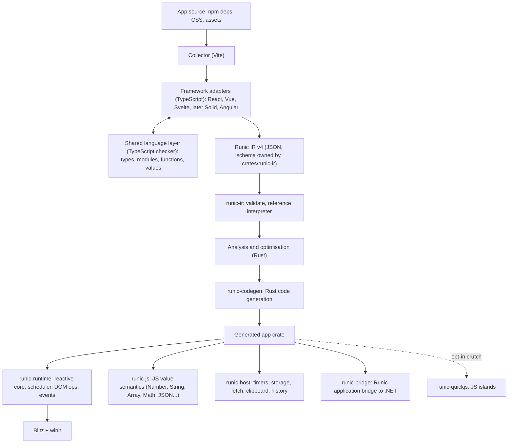

# Architecture

Target architecture and the decisions that constrain it. Rewritten on 2026-10-03 when the project was restructured after Phase 4. The previous version is [history/ARCHITECTURE-PHASE4.md](history/ARCHITECTURE-PHASE4.md); its decisions still apply unless a decision below replaces them. [CONTRACT.md](CONTRACT.md) describes what is implemented today. [ROADMAP.md](ROADMAP.md) describes how we get from there to here.

## Goal

Compile ordinary JavaScript/TypeScript applications written for React, Vue, Svelte and later other frameworks into native Rust desktop applications rendered by Blitz. No Chromium, no WebView, and by default no JavaScript engine. Behaviour the compiler cannot cover is reported with a source-located diagnostic and is never silently changed.

**Purpose.** The compiler fills a gap in the [Runic SDK](/home/viktor/Development/RunicArtifex/runic-sdk). Runic apps are a .NET view model plus a web UI connected by a generated, typed application bridge. Today that UI runs in an OS WebView (for example WebKitGTK on Linux). The compiler provides a deployment path where a WebView is unavailable or unsuitable, or where startup latency matters. This makes *startup time* and *binary size* first-class metrics, and makes the Runic application bridge a first-class integration (D13). The compiler is not tied to Runic: other hosts (for example a Godot UI) are intended users too. The north star is the shadcn sites (the shadcn-svelte documentation site, and the shadcn/ui and shadcn-vue component examples, from pinned GitHub commits; [roadmap](ROADMAP.md), M7); the Runic Translations Editor (`apps/translations-editor` in the SDK) follows with the bridge (M8).

## Pipeline

**Today:** as in the diagram since Milestone 1: the IR, validation, the interpreter and code generation are Rust crates, and the runtime is a library. `runic-bridge` (M8) and `runic-quickjs` (islands, M6 step 10) do not exist yet; host services live in `runic-runtime` and `runic-js`.

## Decisions

| # | Decision | Rationale |
|---|---|---|
| D1 | **The IR is the product boundary.** Its schema is defined once, as Rust types in `crates/runic-ir`, with a JSON Schema exported for the frontends. | Every frontend and every backend change meets at one versioned and validated interface. Hand-written shape checks in two languages would drift apart. |
| D2 | **IR validation, analysis, optimisation and code generation are written in Rust, starting in Milestone 1.** | IR v4 requires rewriting the IR and code generator anyway, so doing it in Rust avoids writing that code twice. This is the deliberate, scoped form of the "future Rust compiler" option. |
| D3 | **Frontend adapters and the language layer stay in TypeScript**, as `.ts` files run directly by Node 24 (type stripping) and checked with `tsc --noEmit`. | Official framework parsers and compilers and the TypeScript checker are JavaScript. Types make the adapter code reviewable. Porting to Rust (oxc and friends) remains a later option (M13). |
| D4 | **The reactive graph is the common semantic core.** IR state is expressed as cells, derived values and effects, plus explicit *scheduling policy* (when writes become visible, when the DOM flushes, effect timing). Adapters choose the policy; the runtime implements the policies generically. | Solid, Svelte 5 runes, Vue refs/Vapor and Angular signals all reduce to this. React's batched re-render model is one scheduling policy combined with *regions* (D5), not a special case in the core. |
| D5 | **Templates are static blocks with dynamic holes.** Holes are text, attribute, property, listener, conditional, keyed list, component instance, slot and *region* (recompute a subtree and reconcile it by key). The runtime constructs Blitz nodes directly and keeps `NodeId` handles. | Fine-grained updates where analysis permits, keyed reconciliation where it does not. There is no HTML re-parsing and no selector lookup on the update path. |
| D6 | **Values are typed natively where types are known.** TypeScript types and inference map to `f64` (with JS semantics), JS strings, `bool`, structs for object shapes, `Vec` for arrays and enums for unions. `runic-js` supplies exact JS semantics: number formatting, UTF-16 string indexing, `Math`, `JSON`, `Array` methods and so on. | Small, fast binaries. Correctness is measured against test262 and against differential runs in Node. |
| D7 | **QuickJS is an opt-in crutch, never the goal.** `--allow-js-islands` lets functions or modules that cannot be lowered run in an embedded QuickJS. Islands compute values and call host capabilities explicitly; they never touch the DOM. Every build reports each island (source location, reason) and the native-coverage percentage. Default builds never include QuickJS. The roadmap tracks island counts towards zero. | It unblocks real applications without letting a JS engine become the de facto architecture. |
| D8 | **Correctness is established for the compiler, not by enumerating each app's state space.** Each IR operation has a reference semantics in the `runic-ir` interpreter. Generated code is differentially tested against that interpreter on generated event traces, and the interpreter and native app are tested against the original framework running in headless Chromium. Exhaustive per-app exploration remains an optional bounded check for small finite apps. | The current approach (enumerate at most 4,096 reachable states) cannot scale past toy apps. |
| D9 | **Mapping packs generalise to library APIs.** A pack matches a resolved `package@version` export (or a pure helper shape), supplies a native implementation and is accepted only after differential validation against the real library in Node. Model-assisted discovery proposes packs; it never accepts them. Normal builds use pinned packs deterministically. | This keeps the Phase 1 acceptance discipline while covering the dependencies that real apps actually use. |
| D10 | **Framework and version knowledge lives only in adapters and packs.** The Rust backend never branches on framework names. Version upgrades run the conformance suite against the original runtime and change only the affected adapters. | This is unchanged from the original architecture. |
| D11 | **The Blitz revision is pinned. Fixes go upstream first.** Local patches live in a documented patch set and are re-evaluated whenever the pin moves. | The archived Blitz/Blazor initiative carried 137 patches. Use [the review](reference/BLITZ-BLAZOR-REVIEW.md) to find relevant fixes rather than re-discovering them. |
| D12 | **The renderer is a per-project choice.** `runic.json` selects `"renderer": "cpu"` (Vello CPU, the default) or `"gpu"` (Vello on wgpu). The choice maps to `runic-runtime` cargo features, and only the selected backend is linked. Pixel conformance is pinned to the CPU renderer. GPU builds run the same gates, pixels included, for selected cases (`conformance/run.mjs --renderer gpu`), drawn on Mesa's software Vulkan driver (lavapipe) from the locked shell. | Projects trade portability and determinism against rendering throughput. anyrender already abstracts both backends. The GPU pixel runs (M6, previously semantic conformance plus smoke rendering) became possible once the probe could draw with the GPU renderer headlessly; lavapipe from the flake makes them independent of the machine's GPU, so GPU-only differences (filters, anti-aliasing, gradient sampling) are found by the oracle instead of by users. |
| D13 | **The Runic application bridge is a native capability.** The SDK generates a typed contract between the C# view model and the TS client. The compiler recognises the generated client by its generator identity and contract metadata and replaces it with native Rust calls into the .NET side. It does not compile the client's JSON wire code. The process and ABI model (in-process NativeAOT library over a C ABI, or a separate process over IPC) is decided in M8 by a measured spike, after a host-agnostic embedder interface has been proven with a Godot host. | Real Runic apps are useless without their view model, and the typed contract makes an exact native mapping possible. The archived Blitz/Blazor initiative's C ABI is a reference. |
| D14 | **Framework priority follows the SDK.** Svelte (with a static SvelteKit SPA subset) is the lead frontend: every capability milestone must pass in Svelte. React and Vue keep their adapters and follow in the same milestone when the adapter cost is small; otherwise they keep explicit diagnostics until a later milestone. Angular, which the SDK also ships, is the next new frontend after the north star. | The SDK's web packages are Svelte, SvelteKit and Angular, and the north star's full application (shadcn-svelte) is SvelteKit. This replaces the earlier "React first" ordering. React stays the reference for re-render semantics. |
| D15 | **Platforms are added one at a time.** Linux (X11 and Wayland) must be complete for the north-star app first. Windows comes next, then macOS. | Each platform needs its own windowing, input, IME and packaging verification. |
| D16 | **Values follow the JavaScript model with static types.** Numbers are doubles, strings UTF-16, `null` and `undefined` stay distinct, and objects, arrays, maps, sets and closures are shared references with identity. The frontend derives a static IR type for every value from TypeScript (or from the lowered code in untyped JavaScript) and rejects what it cannot type. *Amended 2026-10-07:* a program may opt in to dynamic values (`runic.json` `"dynamicValues": true`, [M6-DYNAMIC-VALUES](design/M6-DYNAMIC-VALUES.md)): what has no static type then has the type `dyn`, with ECMAScript semantics in `runic-js`, and is checked where it meets static types (a mismatch throws, never coerces). Static types stay preferred wherever they are found. | Exact observable semantics without a JS engine; the typed representation lets generated Rust stay direct ([M2-VALUES](design/M2-VALUES.md)). |

## Runtime model (target)

- **Instances.** Each component lowers to a generated Rust struct holding its cells, derived values, effect handles and DOM handles. Static children are inlined. Instances under conditionals and lists are created and dropped at runtime, which gives them explicit lifetimes and cleanup.
- **Scheduler.** There is a single native event loop on winit. Event dispatch, microtasks, timers, effects and DOM flush run in the order required by each adapter's declared policy. Async/await lowers to Rust futures driven by this loop.
- **DOM.** `runic-runtime` owns typed operations on Blitz (create, insert, move, remove, set text/attribute/property, listen) and live control state (value, selection, composition, focus). Probe and trace hooks used by conformance live behind a cargo feature and are absent from release apps.
- **Host services.** These are explicit capabilities declared in the IR (`timers`, `storage`, `fetch`, `clipboard`, `history`, ...). An app that declares none links none.

## Verification layers

| Layer | Oracle | Automation |
|---|---|---|
| IR validity | `runic-ir` validator | unit tests, malformed-IR fuzzing |
| Codegen correctness | `runic-ir` reference interpreter | differential traces, every build in CI |
| JS value semantics | test262 subset, Node | `runic-js` test suite |
| Framework semantics | original framework in headless Chromium | conformance harness (`conformance/`) |
| Rendering | browser DOM/geometry snapshot, then pixels with the existing calibrated tolerance | conformance harness |
| Desktop input (OS keyboard, IME, Wayland) | real compositor sessions | separate platform track. An incomplete check never counts as a pass. |

The honesty rules from Phases 1–4 still apply: a missing stage is *incomplete*, not passed; never force blur, drop cases or rewrite reference output to manufacture parity; internal events never close an OS-input gate.

## Design checklist for new capabilities

### Chromium parity: logical text metric quantization (2026-10-08, isolated)

Parley's existing `quantize` boolean keeps its device-pixel contract and default.
An opt-in `QuantizationMode::Logical` on all three builders and `PlainEditor`
rounds ascent, descent and normal-line-height font leading in pre-scale logical
units, then returns device-space metrics. Half-leading is floored in the same
logical units. Explicit line heights, x-height, baseline shifts, atomic box
dimensions and accumulated line positions retain fractional geometry in this
mode; glyph advances and shaping are unchanged. `Device` preserves every
existing rounding site. With `quantize=false`, either mode remains unquantized.
Builders reset to `Device`; editor mode persists across refreshes and invalidates
layout when changed. Logical mode requires a finite positive scale.

Blitz selects logical mode consistently for ordinary text, list markers,
placeholders and editors. Its CSS boxes remain in CSS units; Parley receives the
viewport scale and returns device units once. Painting, selection and caret
geometry consume those same line metrics, without a painter-only correction or
new compiler/IR switch. Font synthesis, variation precedence, theme painting and
raster coverage remain separately owned work.

The motivating Chromium implementation uses integer HTML font metrics and
floors half-leading before device scaling ([font metrics](https://raw.githubusercontent.com/chromium/chromium/main/third_party/blink/renderer/platform/fonts/font_metrics.h),
[leading calculation](https://raw.githubusercontent.com/chromium/chromium/main/third_party/blink/renderer/core/layout/inline/line_utils.cc)).
These moving implementation links are explanatory; the behavior oracle uses the
locked Chromium binary. Acceptance compares identical inputs at DPR 1/1.25/2,
12/14/16/24px, fractional origins, Latin/Arabic and ordinary/input/textarea text,
with focus, selection and collapsed caret states. Existing table, editor,
font-instance and glyph gates remain independent. The local public API still
requires upstream review before integration.

### Chromium parity: document mode and empty line struts (2026-10-08, isolated)

HTML parsing owns document mode. Blitz exposes the existing Stylo
`QuirksMode` enum and `BaseDocument::{quirks_mode,set_quirks_mode}`; the node
tree, stylist and device retain the same mode after resolve. A new document
defaults to `NoQuirks`.
Only full-document HTML parsing sets it; fragment insertion preserves the
containing document's mode. Full quirks mode adds legacy control box sizing at
UA origin, so authored `box-sizing` still wins. Limited quirks keeps standards
control sizing. This is not a claim of complete quirks CSS parsing support.

Parley exposes `Layout::set_include_root_strut(bool)`, defaulting to `true`
and reset to that default when a builder reuses a layout. The flag controls
only the unconditional root font contribution before line breaking. Actual
text and atomic boxes retain their metrics, alignment and scale. Blitz turns
it off for ordinary inline layout in quirks and limited-quirks documents,
following the [blocks ignore line-height quirk](https://quirks.spec.whatwg.org/#the-blocks-ignore-line-height-quirk).
Editors retain the default so empty controls still have caret geometry.
Neither API changes metric quantization or introduces a coordinate offset.
Paired document modes, text versus atomic-only lines, authored sizing and
fragment replacement are the acceptance cases. No IR or adapter change is
needed; upstream API review remains required before integrating these local
pins.

### Chromium parity: face weight ranges (2026-10-08, isolated)

Blitz carries both endpoints of a CSS `@font-face` weight descriptor to
registration. Fontique's optional `FontInfoOverride::weight_range` stores the
advertised interval separately from intrinsic font metadata. Fontique owns
range-aware CSS matching, subset candidates and synthesis: static faces do not
synthesize requests covered by their interval; variable `wght` instances clamp
to the declared interval. Existing single-weight callers retain their behavior
when the optional range is absent. Parley consumes the resulting query without
a Runic or framework-specific path. No IR/schema change is needed. This uses
the existing Parley pin in one isolated worktree, with local overrides pending
reviewed reproducible pins. The new public fields in `FontInfoOverride` and `FontFaceOverrides` break
external exhaustive struct literals; owned callers use `..Default::default()`.
An upstream API/semver decision is required before integration. Width/style
ranges and CSS face tie ordering remain separate gaps.

### Chromium parity: shared visual geometry (2026-10-07, isolated)

Blitz keeps normal-flow layout unchanged and exposes `Node::visual_location()`
to its painter. Sticky constraints belong to Blitz DOM geometry; the same used
offset participates in pointer hits, CSSOM rectangles and hoisted paint children.
Hoisted children expose their intervening overflow-clip ancestors to both
traversals, so changing paint order preserves scrollport clips.
The node tree retains the CSS viewport size beside its existing viewport scroll
and geometry generation. Offsets are derived from layout and current scrolling,
so a scroll does not rebuild the box tree. Runic consumes these primitives rather
than adding another sticky implementation. No IR or adapter interface changes.
`BaseDocument::get_transformed_client_bounding_rect()` centralizes the existing
Runic transform arithmetic for the runtime and direct probes; the untransformed
rectangle remains the input to layout constraints.
The input domain is horizontal writing, including RTL, ordinary block/flex/grid
ancestors and table headers. Chromium cases must certify containing-block limits,
nested scrollports, resize/mutation, all four insets and root scrolling before
removing the sticky rejection; transformed scrollports remain a separate gate.

Stylo's existing physical/logical scroll-margin, scroll-padding and
overflow-anchor definitions are enabled for Servo mode in a separate isolated
patch. Stylo owns parsing, cascade and computed values; Blitz consumes the
generated margin/padding/box getters for scrolling. Computed author values stay
intact when native controls use a different box model: the existing
`TaffyStyloStyle::flags` boundary gains a native-checkable flag applied uniformly
to parent sizing and leaf layout. No CSS parser is added to Runic or Blitz.

Text controls keep their editor scroll separate from box-tree scrolling.
`Node::scroll_position()` exposes the CSSOM value by copy; `scroll_offset()`
continues to describe scrolling of descendant boxes. Scroll metrics include the
editor's laid-out text. Runic's geometry facade consumes these primitives and
records layout-induced scroll changes before resolving, preserving event traces.

Scroll anchoring belongs to Blitz's layout lifecycle. It selects a visible DOM
candidate before restyle and adjusts the block-axis scroll after layout, with
computed-style suppression and `overflow-anchor:none`. Focused descendants get
priority. The initial domain is horizontal block flow; persistent anchor identity
across candidate removal, vertical writing and the full event-loop suppression
window remain explicit verification gates. Table layout has no anchoring hooks.

Before adding a capability, identify the layer that owns it (adapter, language layer, IR, runtime, host), the observable behaviour to preserve, its input domain, and the conformance cases that prove it, run against each framework's own runtime. A new IR construct needs a framework-independent definition, validator rules, interpreter semantics and a runtime implementation. Bump the schema version whenever the serialised form changes.
## Chromium parity: line-width rounding (2026-10-08, isolated)

Stylo owns the computed border and outline widths consumed by layout, hit testing
and paint. Its Servo `Device` gains opt-in `LineWidthRounding::CssPixel`;
`DevicePixel` remains the default, with the existing app-unit/device-pixel path
unchanged. Blitz selects CssPixel whenever it constructs/rebuilds a device.
The consuming layout and painter cannot apply another compatibility correction.

CssPixel resolves the specified length (including CSS effective zoom) before
rounding: zero stays zero, any positive value below one CSS layout pixel becomes
one, and larger values truncate toward zero. Preserve the positive value before
conversion to integer app units, so `.001px` does not disappear and `1.999px`
does not round up first. Line-width keywords are multiplied by effective CSS zoom
before this operation. DPR/window zoom is a later viewport conversion; changing
it must not change these computed widths. Ordinary lengths and text stroke width
are unaffected. Gecko behavior is unchanged.

The device policy is set by a consuming builder method, before attaching it to a
stylist. There is no dynamic setter bypassing style invalidation. Default-created
devices retain DevicePixel; Blitz's shared device factory preserves CssPixel
across rebuilds. Computed inheritance retains the rounded parent value. This patch
does not change animated-value conversions or outline-offset rounding. The
supplemental oracle verifies sampled border/outline animation; broader transitions,
additivity and animated CSS-zoom interaction remain separate gates.

Chromium's border converter explains the policy; the locked Chromium binary is
the acceptance oracle. `line-width-grid.mjs` checks resolved widths independently
at 0.02 CSS px, geometry at the existing 0.125 CSS px and local pixels at MAE 3,
with DPR 1/1.25/1.5/2, tiny/fractional/keyword/calc widths, inheritance, style
changes, ordinary elements and controls. Numeric and keyword CSS zoom cases pass
on this branch. The [verification record](../conformance/results/chromium-line-widths.md)
retains independent raster failures and source pins.

## Chromium parity: inline font content bounds (2026-10-08, isolated)

Parley adds `Line::style_content_bounds(style_index) -> Option<(f32, f32)>`.
This read-only API returns the first available font's ascent/descent bounds at
that style's aligned baseline, in layout coordinates. Leading, fallback glyph
overflow and descendant atomic boxes do not enlarge that span's content area.
It uses existing resolved metrics and the active quantization policy; invalid
indices return `None`. Builders, editors and the Device default are unchanged.

Blitz owns the CSS border-area expansion: its private `TextLayout` helper adds
vertical padding/border, resolving percentages against the inline context's
content width. DOM fragments, offsets/bounding unions and pointer targets share
these block bounds. Collapsed trailing whitespace is excluded from a wrapping
fragment; preserved whitespace is retained. DOM reads and pointer targeting also
share each positioned run's visible advance. Pointer candidates use positioned
runs with leaf-to-ancestor pointer/visibility checks; later matching text runs
win, after atomic children have been visited. Caret lookup remains cluster-based
and selection/caret geometry keeps its line-box semantics.

Visual traversal bounds conservatively include overflowing font content so short
line heights do not prevent ancestor hit descent. Blitz contributes that content's
bottom to Taffy's scrollable-overflow output without increasing block height;
the synthetic empty line after a terminal break is excluded, as it already is
from measured height and last baseline. Existing overflow clipping is retained.
These are font metric bounds, not a model of fallback glyph ink or stacked marks.
The run/ancestor/style scans need profiling before adding a cache; any cache must
cover style/font/width/scale refresh and intrinsic-query layout copies.

The [CSSOM View fragment rules](https://www.w3.org/TR/cssom-view-1/#dom-element-getclientrects)
and [CSS inline content-area rules](https://www.w3.org/TR/CSS2/visudet.html#inline-non-replaced)
guide the reduction; locked Chromium remains the acceptance oracle. The direct
probe now measures tagged `getClientRects()` lists independently of bounding
unions, with the existing 0.125 CSS px tolerance. Hits, editor/scroll state and
local MAE 3 remain independent gates. This API does not certify margins,
horizontal border/padding flow, empty spans or the complete bidi fragment model.
The compiler's integrated inline-rect rejection is not broadened by this patch.
The [continuation record](../conformance/results/chromium-inline-fragments.md)
keeps the 12 newly exposed leading-gap pointer failures and all local pixel
failures. A shared hit-location footprint needs its own pinned Chromium reduction;
neither whole-line hit regions nor DOM-rect tolerances define that policy.

Horizontal margins require a distinct line-layout representation. The next
design checkpoint is a generic ordered span-edge advance, with explicit owner
and start/end association and stable ordering alongside atomic items. A separate
positioned-edge iterator avoids adding a source-breaking variant to public
`PositionedLayoutItem`. Edges must participate in shaping boundaries, intrinsic
measurement, pending whitespace, breakpoint lookahead/replay and positioning
without turning the span into an atomic box. Zero/no advances preserve existing
defaults; negative advances need explicit cases. Own margin advances stay outside
its border rect and hit region; an enclosing span can include a descendant's
advance in its content extent.
Percentages use the context's content width; indefinite intrinsic queries and
retained-layout restoration must be covered. Empty/whitespace spans and first/
last wrapped-fragment ownership need dedicated cases before that interface is
frozen. CSS span direction versus adjacent glyph bidi level remains an explicit
design dependency, including Arabic in LTR spans and Latin in RTL spans.

## Chromium parity: pointer footprint (2026-10-08, isolated)

Blitz DOM owns a private `HitLocation`, constructed once at pointer traversal
entry. It retains the original point for event/caret coordinates and a 1 CSS px
footprint whose origin is floored to 1/64 CSS px. Translation moves both; inverse
affine transforms map the complete quad and preserve its area/shape in the local
coordinate space. Singular transforms reject hits. Scrolling translates the
content query after inverse mapping the unscrolled border query. Public `hit`
signatures, DOM geometry, Parley metrics and renderer paths are unchanged.
Raw hit boxes and positioning use the same unrounded layout as CSSOM. Hoisted
positions share the positioning-chain walk with painting, selecting the logical
location at each step; painter caches retain their existing rounded geometry.

Intersection policy belongs to the target: ordinary boxes, culled inline
ancestors and traversal bounds use raw positive-area rectangle intersections;
text uses the existing Parley style-primary-font bounds, excluding leading and
span padding/borders, pixel-snapped after accumulated paint offsets. Its owning
span independently retains its raw content box. Ineligible text leaves do not
match text, while eligible culled inline ancestors remain candidates; the
formatting root retains its block-box target.
Rounded contours use snapped border/padding rectangles. Snapping uses
positive-infinity half ties, including negative coordinates. A transformed node
starts a new layer coordinate space. Identity/translation and unit-scale axes
retain residual subpixel offsets; other affine axes discard them after rounding
the accumulated layer offset. The same rule positions hoisted hit candidates.
Rounded clips test the
quad against corner ellipses, rather than accepting its bounding rectangle.
The [explicit point oracle](../conformance/pointer-geometry.mjs) preserves small
and large text gaps, exact edges, fractional origins, scaling, rotation/skew,
rounded clips and scroll mutations. It supplements the retained inline/control
checks; this checkpoint defines an implementation boundary, not a parity claim.

The [verified checkpoint](../conformance/results/chromium-pointer-geometry.md)
passes 234/234 standard hits and 216/234 explicit-point states in the new oracle,
but retains 81 newly failing hit states in other inline matrices. The flattened
`TextBrush` stores a styled element id; it does not identify the actual DOM text
node for a shaped byte range. Chromium’s first/previous-sibling culled-inline
ordering therefore needs source-range provenance before it can be reproduced.
Do not infer that ordering from a brush id or protect descendants with an
unconditional ancestry priority. Generic margin advances and per-fragment
ownership remain text/layout work; geometry consumers must not repair positions.

## Chromium parity: text provenance (2026-10-08, isolated)

Parley owns whitespace normalization and offers optional opaque source ids on
`TreeBuilder::push_text_with_source`. `build_into_with_sources` returns normalized
UTF-8 byte ranges and their ids alongside the text. Collapsed spaces retain the
first contributing source; removed whitespace has no range. Existing builder
methods and shaping/style boundaries are unchanged. Metadata does not affect
fonts, line breaking, bidi, glyphs or positioned-item enum variants.

An additive `GlyphRun::text_range` exposes its complete shaping atoms. Blitz
records versioned DOM text ids after text transforms; untagged synthetic text
keeps its existing brush owner. The map lives with `TextLayout`, is cloned for intrinsic queries,
and is replaced on reconstruction. A private inline hit module combines it with
positioned clusters, traverses fragments in reverse paint order, and tests text
before eligible culled parents. A parent is deferred while the preceding fragment
belongs to its subtree. Parent rectangles remain distinct from snapped text
rectangles. The source-order oracle covers adjacent same-style text nodes,
ligatures, nesting, bidi, whitespace, atomic content and DOM replacement. This
interface does not implement span margin advances or establish full bidi parity.

A separate conservative per-line gate precedes snapped leaf targeting. It uses
raw line boxes (including leading), span/font overflow bounds and outward-rounded
glyph ink from existing font data. Unknown font ink, synthesis skew or embolden, decorations,
shadows and atomic content retain traversal. This is a conservative bound, not a
complete implementation of Blink's paint ink overflow. It prevents an exact gap
boundary from reaching the next line merely because that line's text box snaps
upward. Neither ink bounds nor provenance seams become pointer targets: ligature
atoms stay intact, and the styled element remains the public hit target.

## Chromium parity: missing primary-font x-height (2026-10-08, isolated)

An additive `parley_engine::FontMetrics::synthesize_x_height` measures the hinted
lowercase x contour when a font has no declared x-height. It owns font parsing,
variation resolution and outline measurement; DOM layout and hit testing do not
estimate this metric. The helper uses normal automatic hinting with symmetric
antialiasing, returns an optional contour height, and does not mutate
shaped-run metrics. Missing mappings, outlines or usable bounds remain unavailable.

Parley's enabled logical metric policy alone requests this fallback, at the
unscaled logical font size, then scales the result into layout coordinates.
Declared OS/2/MVAR metrics take precedence. Device mode, disabled quantization,
fontless fallback and the public metric structure retain their existing behavior.
This policy matches the locked Linux Chromium web-font oracle; it does not promise
every platform's font hinting configuration. Font metrics, span layout, hit regions
and glyph paint remain separate modules. The middle-alignment oracle measures
box/fragment geometry, hits and paint independently over sizes, origins and DPRs.

## Chromium parity: per-line nested alignment (2026-10-08, isolated)

Parley's enabled logical policy resolves parent-relative inline alignment from
the content participating on each line. A private layout module collects direct
text metrics, fallback runs and atomic boxes, then aligns descendant unions
bottom-up. Participating ancestors retain their own span metrics, including
textless ancestors in standards mode. The root strut remains explicit;
top/bottom descendants retain independent aligned subtrees.

Per-line span offsets belong to line-breaking output, alongside subtree offsets.
Glyph positioning, span content bounds and atomic positioning consume these
offsets through the existing line API. Style metrics remain font/line-height
inputs; DOM geometry and hit testing do not correct alignment. Saved breaking
opportunities retain the participating metrics with their line state, and
intrinsic layout reconstruction recomputes them. Device mode and disabled
quantization retain the existing eager calculation. No IR or public API changes
are required. Nested geometry, fragment lists, hits and paint are independent
acceptance gates, with both ancestor and descendant observations.

Blitz converts atomic-box CSS length shifts to layout units at the adapter
boundary, using the same scale as box dimensions and baselines. Text spans
continue to supply CSS units to Parley's style resolver, which scales them once.

## Chromium parity: inline text paint anchors (2026-10-08, isolated)

Blitz's paint layer owns CSS-space text-origin snapping. An ordinary line supplies
the initial anchor; a materialized non-atomic inline box replaces it for its
descendants, while culled spans inherit it. The signed correction is computed
before the renderer's device-space glyph quantization. Glyphs and text decorations
share that correction; selection, inline backgrounds, geometry and hit testing
retain layout coordinates. Font hinting and raster coverage remain renderer concerns.

Parley's additive `Line::style_font_metrics(style_index)` accessor returns the
primary span's ascent/descent in layout units, with its existing quantization
policy, or `None` for an invalid index. This lets paint compare parent and child
font heights without querying fonts again or deriving metrics from aligned bounds.
It neither changes line breaking nor exposes the private alignment arenas. The
paint implementation stays private to Blitz; no IR or framework adapter changes
are required. Fractional origins, box materialization and mutations have separate
geometry, fragment, hit and strict local pixel gates.

## Chromium parity: empty inline participation (2026-10-08, isolated)

Parley's tree builder offers opt-in `set_empty_span_participation(bool)`. Ordinary
style spans that produce neither normalized text nor an atomic box retain a
zero-advance anchor and their own primary-font metrics. Style-modification scopes
remain normalization scopes, so a CSS `display:contents` whitespace scope cannot
acquire an element box. The default stays disabled and builders reset it.

Normalization owns anchor placement across delayed collapsed spaces. Line
breaking consumes anchors in text order, before taking the following break
opportunity; saved opportunities and explicit replay retain the same cursor and
participating metrics. Baseline-aligned anchors preserve compatible adjacent-text
shaping. An empty non-baseline vertical alignment is a normalized shaping boundary,
derived privately before itemization; it creates no text, source entry, inline
advance or caret stop. It blocks a ligature across the boundary while retaining
ligatures within each side. This follows pinned Chromium's
[boundary predicates](https://chromium.googlesource.com/chromium/src/+/971a7443b0c9b0a9b2860529b33331b76077ec62/third_party/blink/renderer/core/layout/inline/inline_node.cc#493)
and [zero-length tag scan](https://chromium.googlesource.com/chromium/src/+/971a7443b0c9b0a9b2860529b33331b76077ec62/third_party/blink/renderer/core/layout/inline/inline_node.cc#1632).
Shaping boundaries remain distinct from future span-edge advances. The additive read-only
`Line::empty_spans()` iterator returns style indices and positioned inline offsets
in layout units; the positioned-item enum remains unchanged. Geometry consumers
combine these offsets with the existing own-font content bounds.

Blitz enables this policy for standards-mode ordinary inline contexts. It binds
styles to DOM owners and includes zero-width fragments in geometry. Empty-only
lines remain invisible for block sizing; their font-area fragments remain
observable. Quirks mode, inline margins/padding advances, generated pseudo layout
ownership and full bidi boundary behavior remain independent parity work. No
framework, IR, renderer or font-hinting change is involved.

The private boundary derivation covers retained empty spans whose Parley alignment
value differs from BASELINE. CSS vertical-align:0px has the same geometric value
as BASELINE in the current representation, while Blink retains a distinct
[kLength category](https://chromium.googlesource.com/chromium/src/+/971a7443b0c9b0a9b2860529b33331b76077ec62/third_party/blink/renderer/core/style/computed_style_constants.h#238).
Explicit caller boundary intent for that category, nonempty spans and horizontal
edges requires a separate additive API checkpoint. No epsilon encodes that intent.
The [verified continuation](../conformance/results/chromium-empty-inline.md) keeps
shaping correctness and the eleven new tight-crop pixel failures separate.

## Chromium parity: caller shaping-boundary intent (2026-10-08, isolated)

Parley adds `TreeBuilder::push_style_span_with_shaping_boundaries(style, before,
after)`. Each boolean requests an itemization boundary at that ordinary span's
normalized opening or closing position. Existing span pushes request neither;
modification scopes remain normalization-only. Requests are independent of empty
participation and geometric alignment. Automatic span closing records the closing
boundary too. Delayed whitespace moves an edge only when that whitespace was
already pending at the edge; later sibling whitespace cannot move it. The final
private stream unions these requests with existing empty non-baseline boundaries,
sorts and deduplicates interior UTF-8 byte positions, then uses the existing
itemizer. No source ids, synthetic characters, layout items or advances encode intent.

This API prevents a shaping run or ligature from crossing a requested edge.
The engine's existing full-text context and forced grapheme-start behavior remain;
complete contextual isolation, Unicode grapheme/caret parity and bidi affinity
require separate reductions. Internal ligatures on either side remain eligible.
Both geometry and tight paint stay independently gated.

Stylo retains an `ImplicitZero` baseline-shift value for the initial and
shorthand-omitted shift, distinct from an explicitly parsed zero length. The
existing `zero()` numeric constructor remains unchanged. A new `implicit_zero()`
constructor supplies the initial value. This category follows normal cascade,
inheritance, variables, value equality and style invalidation. Longhand CSSOM and
Typed OM expose the same numeric zero; shorthand serialization distinguishes
`baseline` from an explicit `0px`. Numeric longhand animation treats implicit
zero as numeric zero and preserves the category only when both endpoints are
implicit, retaining existing interpolation. CSS2 keyword/length shorthand
animation remains a separate parity gate in Stylo's longhand model.

Blitz requests both ordinary-span boundaries in standards mode when computed
alignment differs from baseline or the shift is not implicit zero. It converts
the implicit value to exactly zero geometric shift. `display:contents` continues
to use modification scopes; atomic boxes retain their existing shaping boundary.
Pure alignment restyles update cached layout metrics while retaining shaped text,
following pinned Blink's layout-only invalidation. Fresh shaping uses current
boundary intent; recollection can itself reuse cached shapes. Font/text changes
and their shape-reuse rules remain independently gated. Paint uses geometric zero
for its existing anchor decisions. Horizontal edge advances and
their per-side boundary predicates remain the next generic-flow slice; no IR,
framework, renderer or global ligature policy changes are required.

Parley's additive `Layout::update_vertical_alignments(&[Option<VerticalAlign>])`
accepts one entry per collected style in layout units; `None` keeps that entry.
It returns false for a mismatched length without changing the layout. Valid
updates recompute alignment metrics parent-first from cached font/line metrics,
without font queries, itemization, source changes or glyph changes. Callers must
break lines again before consuming their positions, like other layout setters.
Unchanged updates are a no-op. Blitz supplies the current CSS alignment for each
retained style owner before line breaking and refreshes atomic-box alignment in
its existing box-update loop. CSS remains in Blitz/Stylo; Parley owns alignment
and both breaker paths. Device, logical and unquantized policies remain separate
focused gates. The [refresh oracle](../conformance/inline-shaping-refresh.mjs)
compares style-only history with a subsequent font-triggered reshape after
restoring the initial alignment. Horizontal geometry is the browser shaping
proxy; it does not instrument Blink's glyph/cache identity or prove resetting
every differing stale category.

Setting or clearing a style attribute now relies on the computed-style damage
comparison, retaining snapshots, dirty marking and redraw. Changes to text-wrap
mode require recollection. Table owners additionally compare the converted styles
and table/border inputs captured by their box-tree snapshots, rebuilding those
snapshots when geometry changes. Caption geometry, colors and vertical alignment
are read live and retain layout-only invalidation. This owner-specific table rule
keeps cached table geometry correct without forcing every alignment restyle to
reshape text. The [verified checkpoint](../conformance/results/chromium-inline-boundaries.md)
records the full rerun and remaining fragment/paint gaps.

## Chromium parity: ordinary span ownership (2026-10-09, isolated)

The first span-edge checkpoint retains generic normalized owner ranges without
adding advances. Parley's tree builder adds opt-in
`set_style_span_tracking(bool)`, disabled on every new builder. When enabled,
ordinary spans retain opening/closing UTF-8 positions, their style index and both
atomic-box ordinals. Modification scopes remain transparent. Closing positions
follow already-pending whitespace independently of shaping-boundary requests;
later whitespace cannot move an earlier closing edge. Automatic closing uses the
same capture. No text source, shaping boundary or glyph is added by tracking.

The additive `Line::style_span_bounds(style_index) -> Option<(f32, f32)>` returns
one horizontal union in layout units for a tracked ordinary span on that line.
An atom belongs in full to the normalized span containing its first code unit;
owners beginning inside that atom retain a real zero-width fragment at its logical end,
rather than receiving a caret fraction. Descendant text and in-flow atomic boxes
are included by the captured ranges and box ordinals. Empty spans use the existing
empty-span participation and line association; tracking alone does not change
their metric participation. Out-of-flow boxes reserve no width. Returned bounds
follow visual ordering, alignment and justification. Each atom's normalized
whitespace policy trims collapsed hanging space while preserving child whitespace
under a collapsing ancestor. `None` means untracked or absent from that line.
Existing font-area bounds supply the separate block-axis geometry.

The private query consumes the line's committed atoms/boxes, so rebreaking and
saved-state replay use the same final ownership without a second layout cursor.
Default layouts and callers without tracking retain their current behavior.
Canonical text, source ranges, shaping allocations and the public positioned-item
enum remain unchanged. Blitz enables tracking for standards-mode ordinary inline
contexts and uses owned bounds for their CSSOM fragments; CSS and DOM ancestry
remain in Blitz. This does not claim complete bidi fragment segmentation or
Unicode caret parity.

Nonzero margin/padding/border advances require a subsequent interface checkpoint.
They must participate in intrinsic sizing, soft-break rollback, both breakers and
every visual/caret offset consumer. Opening, closing and empty-pair wrap affinity
must be frozen before implementation. Shaping intent remains separate from used
advance, especially for calculated/percentage edges. Parent inline progression,
slice/clone and intrinsic percentage resolution are CSS binding decisions.
The [span-edge oracle](../conformance/inline-span-edges.mjs) retains those failures
while independently measuring zero-advance ownership and font refresh.

## Chromium parity: ordered inline span edges (2026-10-09, isolated)

Before adding horizontal advances, Parley retains a private ordered edge stream
under the existing ordinary-span tracking opt-in. Each edge carries its opening
or closing kind, resolved ordinary style index, normalized UTF-8 position and
the count of atomic boxes preceding that authored edge. The vector follows
authored tree order: nested empty spans open parent-first and close child-first;
adjacent empty siblings close before the next sibling opens. Sorting endpoints
by text position or pairing every opening immediately with its closing loses
this order. Box ordinals remain independent of text positions, including both
out-of-flow kinds, because pending whitespace can move a span anchor past an
out-of-flow box's text position without moving its authored box order.

Opening and closing ordinals are captured with the tree irrespective of when
tracking is enabled. The final tracking setting controls materialization, so
late enable/disable retains the existing ownership API's behavior. Existing
whitespace normalization supplies endpoint positions; automatic closing follows
the same capture. Modification scopes remain transparent. Both tree-builder
output paths transfer the stream into the layout; layout cloning preserves it
and layout reuse clears it. Breaking, alignment and saved-state replay leave the
edge stream unchanged. There is no new public API, text, source range,
shaping boundary, character quota item or advance in this checkpoint.

The separate [flow-affinity oracle](../conformance/inline-flow-affinity.mjs)
records opening/closing wraps, negative displacement, coincident empty edges,
pending whitespace around atomic and out-of-flow items, forced breaks,
parent versus ordinary-inline direction, intrinsic queries and layout mutations.
Its current negative-margin and min-content cases do not change wrapping or the
controlling intrinsic width. Driving reductions remain necessary before those
behaviors can be certified. Own direction changes asymmetric fragment placement;
the next mapping must retain box direction and containing progression separately.
These browser observations are targets for subsequent edge consumption.

The next interface must consume this stream around whole atoms and boxes in both
breakers and intrinsic measurement, saving cursor and active owners in rollback
state. A private visual flow cursor must then supply paint, span/empty geometry,
cluster offsets, caret and selection consistently. Preserve today's distinct
glyphless-spacing and out-of-flow-width behavior until an explicitly opted-in
edge path defines and verifies their replacement. CSS edge resolution, authored
shaping intent and direction mapping stay in Blitz; Parley receives generic used
advances. Slice/clone fragmentation and decoration painting follow after the
zero-advance cursor checks and signed-advance fitting checks.

The [verified checkpoint](../conformance/results/chromium-inline-authored-edges.md)
adds ten focused tests and retains all 4,793 direct results and native whole PNGs
unchanged, with all 389 compiled states passing. No used advances or rendering
consumer changes are implemented by the private stream.

## Chromium parity: private visual content flow (2026-10-09, isolated)

The next private seam extracts committed-line content traversal into Parley,
without consuming used span-edge advances yet. A clonable `ContentFlow` iterator
retains each whole shaping atom's run and line-item identity, visual origin,
glyph count and positioned advance. It also yields atomic boxes with their global
box ordinal, visual origin and in-flow advance. Its f32 cursor starts from
`inline_min_coord + offset`, advances once per whole atom, gives glyphless atoms
zero positioned advance, and reserves width only for in-flow boxes. These are
the existing ordinary-span bounds rules; collapse trimming and ownership remain
in the span-bound consumer.

Empty-anchor box sites retain a separate clonable `BoxFlow` view. It advances
once per run using `Run::advance`, and once per in-flow box, with the same origin.
The view exposes box ordinal and bidi side independently of byte position.
The empty-anchor consumer keeps its cluster preference and collapse clamping.
Do not replace this run-grouped calculation with atom-grouped sums: floating
point grouping and glyphless behavior can differ.

Both views read current committed lines, alignment and justification on demand;
they add no persistent positioned cache, public API, CSS rule, shaping item,
caret stop or renderer change. Ordinary authored-edge tracking continues to
retain metadata only. Paint, cluster/caret and selection retain their current
calculations, including their existing origin, out-of-flow width and f32/f64
differences. A subsequent effective used-edge path must define its canonical
positions explicitly and preserve legacy behavior when every individual used
edge is zero. A net-zero sum is insufficient because opposing edges move
interior positions.

The additive [driving oracle](../conformance/inline-edge-drivers.mjs) measures
negative-margin wrap changes, a controlling min-content edge mutation and an
immediate `br` close. Candidate outputs require observation at the locked browser
revision; they do not instrument provisional overflow or cache identity. Existing
oracles remain unchanged. Opus's stopped thread was inspected before delegation;
its unfinished compiler/runtime hover and form-submission work remains separate.

The [verified extraction](../conformance/results/chromium-inline-flow-views.md)
passes nine focused tests and preserves all 4,820 direct results, native state
JSONs and whole screenshots, with 389 compiled states passing. The new browser
drivers supply the three reductions without proving internal recovery or cache
execution. Used span-edge advances remain a subsequent interface checkpoint.

## Differential pointer endpoints (2026-10-09)

The reference interpreter has no layout. A listener-selected row and the element
at the row's center can differ: the hover reduction selects `item-b`, while the
real native pointer hits its `label-b` child. Delivering directly to the row cannot
compare observable `event.target` or subsequent `relatedTarget` correctly.

For differential traces, the native probe records the normalized live element
hit at the unchanged action point before dispatch. Its identity is an element-only
child path relative to the mount container, accompanied by tag/id assertions and
the point. Browser/native probes using `--visible-targets` retain the same
metadata so their authored traces can also be checked by the interpreter.
The reference CLI validates that metadata and passes a reference-only
`Target::ElementPath`. Target lookup translates it to the existing child-index
path on `fire_action`'s own live tree, without an extra render, and runs the normal
event model. Original
actions and resolved reference actions remain evidence. Missing, unavailable,
shifted or shortened observations make coverage incomplete or failed. Reference
snapshots, comparisons and tolerances are unchanged. Probe capture and native
dispatch continue through real Blitz hit testing; no synthetic event bypass is
introduced.

This delegates endpoint selection to the native layout for compiler/interpreter
event-semantic comparison. It does not independently verify native hit testing;
browser/native conformance and the direct pointer oracles retain that task.
Production rendering, framework adapters and IR schema 4 are unchanged. Hidden
target stops and matching render-error termination remain explicitly incomplete.
Every complete trace must compare the initial state and all generated actions.

### Bounded form submission (2026-10-09)

The [form submission design](design/M6-FORM-SUBMISSION.md) extends existing
event registries within schema 4. Pure HTML ownership, activation, implicit
submission and conservative validation decisions live in `runic-js::forms`;
native DOM and interpreter VNode adapters collect live inputs and own dispatch.
An owned native session releases DOM borrows before synchronous callbacks and
uses a per-form reentrancy guard. Generated code restores nested discrete
priority without inserting a checkpoint. Navigation, reset, undecidable
validation and unsupported validity selectors retain diagnostics. Acceptance
is pending; this decision alone does not extend the implemented contract.

## Chromium parity: private line-flow consumers (2026-10-09)

A borrowed, crate-private `LineFlow` is the entry point for committed-line
horizontal traversal. Its glyph, content, box, cluster and selection views retain
their existing numerical contracts. Glyph placement groups atom advances by
style before adding the line origin; content bounds add whole atoms; empty box
anchors and preceding-cluster offsets add runs. Point lookup keeps its run-skip
and grapheme tests. Selection converts origin components separately to f64,
defers intervening box width until the next cluster, and excludes leading boxes.
These policies are deliberately separate: their rounding, glyphless and
out-of-flow width behavior is not interchangeable.

Vertical bounds, collapse trimming, exact/nearest fallback and newline selection
indicators remain consumer decisions. Cursor rectangles continue to use cluster
visual offsets, including the existing terminal fallback. The views borrow
current line data without allocations or a persistent positioned cache. No
public API, positioned-item variant, text, shaping boundary, caret stop, CSS rule
or used-edge advance is added. This checkpoint does not repair Chromium gaps.

The later effective path must define signed positions around whole atoms and
boxes, then supply all horizontal consumers together. Activate it when any
individual used opening/closing edge is nonzero, including opposing edges whose
sum is zero; preserve these legacy views when all individual components are zero.
Authored ordering, logical consumption and committed visual placement remain
separate. Both breakers and intrinsic traversal need their own logical state;
saved opportunities and external replay must restore the edge cursor, active
owners and committed placement lengths. CSS resolution and decoration ownership
stay in Blitz. The existing three browser drivers supply wrap, controlling
min-content and immediate forced-break targets; internal overflow recovery and
cache execution still need instrumented tests.
