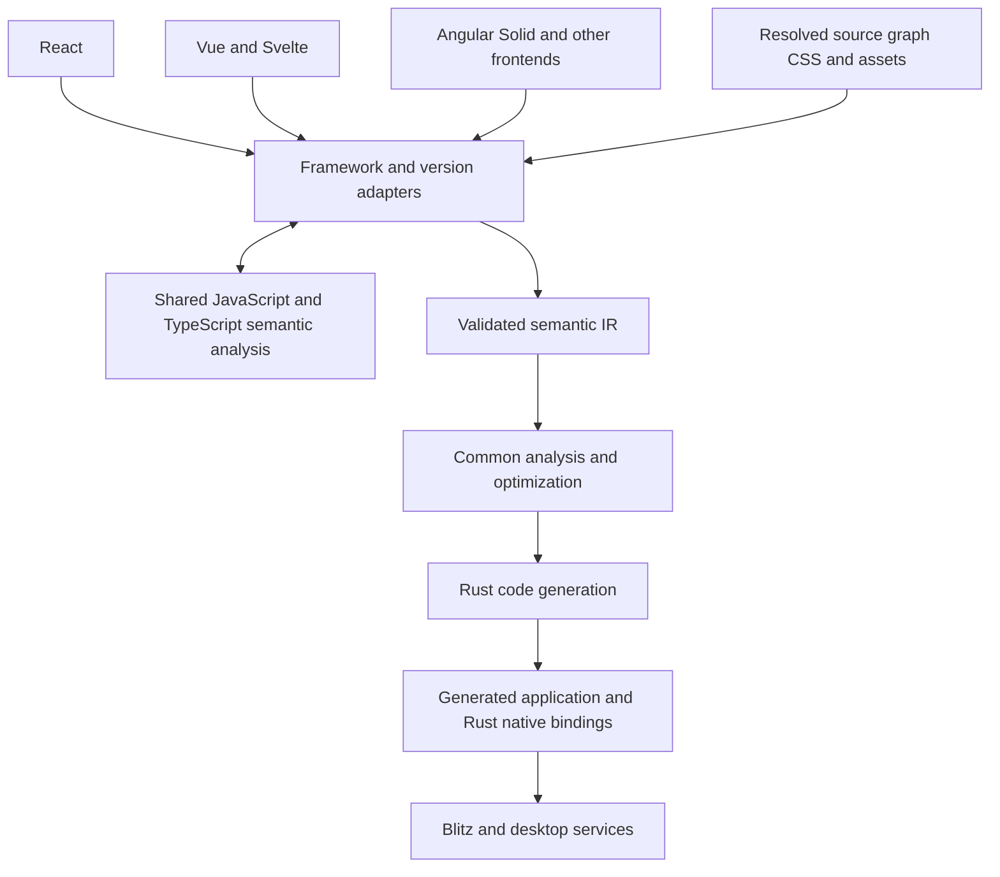

# Compiler architecture and decisions

Recorded on 2026-10-02 after Phase 1 and the review of the cancelled Blitz and Blazor initiative, and updated through Phase 4. This document captures the agreed project direction and the boundaries future work should preserve. [Contract v5](CONTRACT.md) describes implemented support; [Phase 4](PHASE4.md) records the shared module scope; [its results](PHASE4-EVIDENCE.md) describe delivered work and remaining gates.

[Phases 5–8](PHASES5-8.md), planned on 2026-10-03, sequence current conformance, reusable components, finite child-state lifetimes and local application delivery. They are proposed extensions under these decisions, not implemented compatibility.

## Objective

Compile supported behavior from ordinary JavaScript and TypeScript applications into native Rust applications rendered with Blitz. React, Angular, Svelte, Vue, Solid and other frameworks are potential source frontends. React is the first implementation, and support for the others will grow incrementally.

Framework coverage depends on the application's required capabilities and on validated frontend adapters. Supporting a framework does not imply supporting every program or dependency written for it. Unsupported behavior must produce useful diagnostics rather than being dropped or silently changed.

The generated application should contain the native implementations needed for its accepted behavior, with no JavaScript engine required for fully covered applications. Analysis and model-assisted discovery occur during compilation. The native application does not need the build tools or a running model provider.

## Agreed decisions

| Area | Decision |
|---|---|
| Application authoring | Keep JavaScript and TypeScript authoring and framework syntax; developers do not need to rewrite applications in Rust |
| Generated application | Generate Rust for application state, transitions, computations and UI updates |
| Native binding layer | Use Rust to integrate generated code directly with Blitz and native desktop services |
| Compiler architecture | Share semantic analysis, validated IR, optimization and code generation across frontend adapters |
| Framework support | Introduce additional frameworks through adapters and reusable mappings; the compiler core must not become a React runtime |
| Version upgrades | Maintain versioned adapters and conformance tests so upgrades reuse unaffected compiler/backend machinery |
| Discovery | Models propose bounded mappings; compiler-owned validation establishes acceptance; normal builds use pinned rules deterministically |
| Existing initiatives | Keep this project independent of the Runic SDK and treat the cancelled initiative as a reference for selected native behavior and tests |

A future compiler implemented predominantly in Rust is an intended option, not an immediate rewrite commitment. Rust for the generated application and native bindings is already the chosen direction.

## Compiler boundaries

This is a target organization, not a claim that all these interfaces or frontends already exist. The native application boundary starts at generated Rust and its native dependencies; frontend tooling remains on the compilation side.

### Source collection and frontend adapters

Collection records reproducible source graphs, resolved dependency identities, CSS ordering, assets and source locations. Vite is the initial collector, but its outputs should reach the compiler through an interface that another build tool can implement.

An adapter understands its framework's templates or JSX, component construction, state APIs, bindings, scheduling and supported lifecycle behavior. It uses shared language analysis for ordinary expressions and module behavior, then lowers the supported semantics into IR. A new adapter should not duplicate the Rust renderer, native controls or general arithmetic analysis.

Use official parsers, compiler APIs and source information where they preserve the needed semantics. For example, [Svelte exposes parsing and compilation APIs](https://svelte.dev/docs/svelte/svelte-compiler), and [Vue describes compiler-generated dynamic binding information](https://vuejs.org/guide/extras/rendering-mechanism.html). Generated helper patterns and framework-specific internals, when needed, belong behind versioned adapters. Their shape should not become a compiler-wide assumption.

Phase 3 implements that boundary for Svelte 5: its adapter supplies original script extraction and lowers the official modern AST, while the official compiler/runtime supplies the browser reference. Pure scalar derived reads and immediate writes become explicit common expressions; setup captures stay fixed. Schema 3, the validator, Rust generator and native controls remain unchanged. The IR tree plans construction and bindings; native updates already target live nodes, so adding Svelte requires no virtual DOM runtime. Two actual Svelte pins exercise the same source and backend. Effects, object proxies and scoped styles remain separate capabilities rather than being approximated.

### Shared semantic analysis and IR

Shared machinery handles the supported JavaScript and TypeScript computations, types, effects, dependencies and validation. Numeric, string and evaluation-order semantics must remain explicit when lowering to Rust. Preserve the existing exact-integer guarantees until a separately justified domain supports more behavior.

Phase 4 adds `modules.mjs` for ordinary acyclic local modules, consumed by Vue and Svelte. It evaluates immutable scalar initialization from the collected source snapshot, resolves named imports/exports and admits only bounded pure helpers; helper calls reuse existing pinned mappings. Module initialization belongs to the source-language layer, while component setup captures and reactive/handler reads remain adapter semantics. React keeps its existing symbol-based module path and gains explicit named re-exports. Equivalent consumers exercise the same module source across all three frontends. This boundary adds no runtime scheduler or IR operation.

The IR describes application behavior and native requirements. As capabilities expand, it must express state reads and writes, captured values, update ordering and commit boundaries, dependency tracking, stable identity, mounting and disposal, typed input payloads and declared effects. It must distinguish behaviors that are observably different across source frameworks. Identical-looking setter APIs are not sufficient evidence of identical scheduling or closure semantics.

Framework concepts are lowered into explicit operations; the shared core does not execute hooks, Vue component objects or another framework's JavaScript runtime. Framework/version identity remains generic provenance and adapter selection metadata, not an instruction for the Rust backend to branch on framework names. New IR primitives should have an independent semantic definition, validation rules and a native implementation.

One shared semantic contract does not require every frontend to emit identical IR, source hashes or binaries. Differences in source behavior may require different valid operations. Each frontend must preserve its own documented observable behavior.

### Rust code generation and native bindings

Generated Rust owns application state, handlers, derived computations and updates. A shared Rust binding layer owns integration with Blitz: typed input delivery, DOM/live control properties, focus, layout, rendering and window lifecycle. Native services can be added through explicit capabilities when an application needs them.

Develop this layer alongside concrete consumers. Live editor values, selection and composition are stateful control behavior; assigning an HTML attribute or rebuilding a subtree is not automatically equivalent to updating a controlled input. The binding interface must preserve the identities and control state required by the source contract.

The backend consumes IR and capability requirements. It should not need separate React, Svelte or Vue implementations of the same native control. Language uniformity removes a cross-language framework seam, but renderer bugs and desktop/input differences still need native fixes and tests.

## Framework and version maintenance

Each adapter records supported dependency versions, capabilities, source assumptions and conformance cases. Reusable mapping packs record dependency/API applicability, semantic preconditions, required capabilities and accepted validation evidence. Rules may be shared across frameworks when their actual semantics agree; applicability cannot depend only on familiar names.

For a framework upgrade:

1. Resolve the new dependency version through the existing graph interface and inspect changes relevant to supported behavior.
2. Run adapter cases against that version's original browser runtime, including observable ordering and lifecycle cases.
3. Reuse mappings whose assumptions remain valid; update only affected adapters or rules, and retain diagnostics for uncovered behavior.
4. Add shared IR/backend work only when the new semantics require a capability that the existing contract cannot express.
5. Record the supported version and refresh validation/provenance as required by changed inputs.

An upgrade can involve real work, particularly for a semantic change. The architectural requirement is to contain that work and reuse unaffected layers, rather than begin a new compiler for every framework release. Official compiler APIs can reduce parsing work; they do not themselves prove equivalence of our native lowering.

## Validation beyond finite state

Phase 1 validates a small closed state machine by exhaustive exploration, with at most 4,096 reachable states and finite string enums. Editable text cannot fit that approach even when text length is bounded. Increasing the enumeration limit does not establish a sound general model.

Phase 2 combines exact finite exploration with a typed text domain and a sound length projection for its permitted operations; see [typed text validation](TEXT-VALIDATION.md). Extensions must specify event payloads, length/Unicode constraints, state/control boundaries and the guarantees each analysis establishes. Preserve finite-state regressions. Concrete traces and differential tests provide additional evidence, but must not be described as an exhaustive proof of all text inputs.

Cross-framework tests should compare each source implementation with its own runtime oracle. They should deliberately include cases that expose different update semantics. Reusing a Blazor test scenario is useful; importing its expected event ordering into React or another frontend without checking that runtime is not.

## Future compiler language

The prototype uses TypeScript's tooling and Node-hosted compiler code. That is an implementation choice separate from the language of the generated application and native bindings.

After the adapter/IR boundaries are exercised, IR validation, analysis, optimization and code generation are natural candidates for incremental Rust implementation. Framework parsers or build integrations may remain separate build-time tools where that is useful. Preserve source locations, deterministic outputs and the validation suite during migration. Do not let a language migration and new framework support obscure whether a behavioral change is correct.

## Current architectural debt

Phase 2 exercises the boundary with React and Vue: source collection delegates framework tooling, `language.mjs` owns shared expression lowering, adapters own source/scheduling semantics, and schema 3 records generic provenance. The Rust backend shares live controls and explicit semantic operations. Schema 2 finite artifacts retain an explicit migration path.

Phase 3 adds Svelte as a third frontend without changing that IR/backend. Its own runes and parser syntax exercise immediate writes, intermediate derived reads and ordinary setup captures; the original Svelte runtime remains the conformance authority. See [Phase 3 results](PHASE3-EVIDENCE.md).

Phase 4 removes the single-source-file limitation from Vue/Svelte through a shared module analyzer. Both still support one component. Component props, state lifetimes and mounting/disposal need their own validated composition contract. See [Phase 4 results](PHASE4-EVIDENCE.md).

Remaining limits are concrete: Vite is still the only collector; Vue and Svelte each support one component; text supports one length-abstracted slot; clipboard/platform IME behavior and full desktop keyboard delivery are not certified; other frameworks and lifecycle/async behavior need future adapters/capabilities. The compiler remains Node-hosted. These are future extension points, not implemented compatibility claims. Preserve [Phase 1 evidence](PHASE1-EVIDENCE.md) and [Phase 2 results](PHASE2-EVIDENCE.md).

## Design review questions

Before adding a capability or changing an interface, identify which layer owns it, the observable behavior to preserve, its input domain and the evidence needed to support it. Check whether another frontend can use the same operation without inheriting React assumptions. Document version-sensitive assumptions at the adapter boundary. Use an actual consumer to justify a new abstraction, and keep implemented support distinct from proposed scope.
