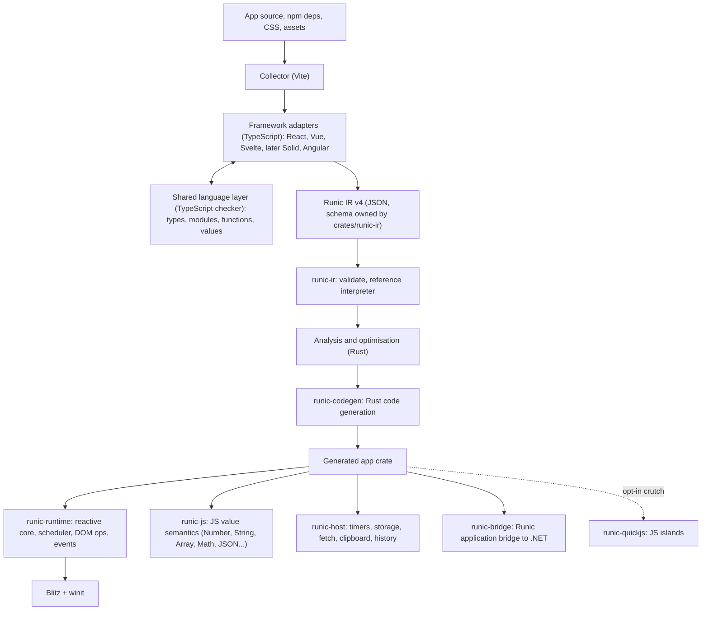

# Architecture

Target architecture and the decisions that constrain it. Rewritten on 2026-10-03 when the project was restructured after Phase 4. The previous version is [history/ARCHITECTURE-PHASE4.md](history/ARCHITECTURE-PHASE4.md); its decisions still apply unless a decision below replaces them. [CONTRACT.md](CONTRACT.md) describes what is implemented today. [ROADMAP.md](ROADMAP.md) describes how we get from there to here.

## Goal

Compile ordinary JavaScript/TypeScript applications written for React, Vue, Svelte and later other frameworks into native Rust desktop applications rendered by Blitz. No Chromium, no WebView, and by default no JavaScript engine. Behaviour the compiler cannot cover is reported with a source-located diagnostic and is never silently changed.

**Purpose.** The compiler fills a gap in the [Runic SDK](/home/viktor/Development/RunicArtifex/runic-sdk). Runic apps are a .NET view model plus a web UI connected by a generated, typed application bridge. Today that UI runs in an OS WebView (for example WebKitGTK on Linux). The compiler provides a deployment path where a WebView is unavailable or unsuitable, or where startup latency matters. This makes *startup time* and *binary size* first-class metrics, and makes the Runic application bridge a first-class integration (D13). The compiler is not tied to Runic: other hosts (for example a Godot UI) are intended users too. The north star is the shadcn sites (the shadcn-svelte documentation site, and the shadcn/ui and shadcn-vue component examples, from pinned GitHub commits; [roadmap](ROADMAP.md), M7); the Runic Translations Editor (`apps/translations-editor` in the SDK) follows with the bridge (M8).

## Pipeline

**Today:** as in the diagram since Milestone 1: the IR, validation, the interpreter and code generation are Rust crates, and the runtime is a library. `runic-bridge` (M8) and `runic-quickjs` (islands, M6 step 10) do not exist yet; host services live in `runic-runtime` and `runic-js`.

## Decisions

| # | Decision | Rationale |
|---|---|---|
| D1 | **The IR is the product boundary.** Its schema is defined once, as Rust types in `crates/runic-ir`, with a JSON Schema exported for the frontends. | Every frontend and every backend change meets at one versioned and validated interface. Hand-written shape checks in two languages would drift apart. |
| D2 | **IR validation, analysis, optimisation and code generation are written in Rust, starting in Milestone 1.** | IR v4 requires rewriting the IR and code generator anyway, so doing it in Rust avoids writing that code twice. This is the deliberate, scoped form of the "future Rust compiler" option. |
| D3 | **Frontend adapters and the language layer stay in TypeScript**, as `.ts` files run directly by Node 24 (type stripping) and checked with `tsc --noEmit`. | Official framework parsers and compilers and the TypeScript checker are JavaScript. Types make the adapter code reviewable. Porting to Rust (oxc and friends) remains a later option (M13). |
| D4 | **The reactive graph is the common semantic core.** IR state is expressed as cells, derived values and effects, plus explicit *scheduling policy* (when writes become visible, when the DOM flushes, effect timing). Adapters choose the policy; the runtime implements the policies generically. | Solid, Svelte 5 runes, Vue refs/Vapor and Angular signals all reduce to this. React's batched re-render model is one scheduling policy combined with *regions* (D5), not a special case in the core. |
| D5 | **Templates are static blocks with dynamic holes.** Holes are text, attribute, property, listener, conditional, keyed list, component instance, slot and *region* (recompute a subtree and reconcile it by key). The runtime constructs Blitz nodes directly and keeps `NodeId` handles. | Fine-grained updates where analysis permits, keyed reconciliation where it does not. There is no HTML re-parsing and no selector lookup on the update path. |
| D6 | **Values are typed natively where types are known.** TypeScript types and inference map to `f64` (with JS semantics), JS strings, `bool`, structs for object shapes, `Vec` for arrays and enums for unions. `runic-js` supplies exact JS semantics: number formatting, UTF-16 string indexing, `Math`, `JSON`, `Array` methods and so on. | Small, fast binaries. Correctness is measured against test262 and against differential runs in Node. |
| D7 | **QuickJS is an opt-in crutch, never the goal.** `--allow-js-islands` lets functions or modules that cannot be lowered run in an embedded QuickJS. Islands compute values and call host capabilities explicitly; they never touch the DOM. Every build reports each island (source location, reason) and the native-coverage percentage. Default builds never include QuickJS. The roadmap tracks island counts towards zero. | It unblocks real applications without letting a JS engine become the de facto architecture. |
| D8 | **Correctness is established for the compiler, not by enumerating each app's state space.** Each IR operation has a reference semantics in the `runic-ir` interpreter. Generated code is differentially tested against that interpreter on generated event traces, and the interpreter and native app are tested against the original framework running in headless Chromium. Exhaustive per-app exploration remains an optional bounded check for small finite apps. | The current approach (enumerate at most 4,096 reachable states) cannot scale past toy apps. |
| D9 | **Mapping packs generalise to library APIs.** A pack matches a resolved `package@version` export (or a pure helper shape), supplies a native implementation and is accepted only after differential validation against the real library in Node. Model-assisted discovery proposes packs; it never accepts them. Normal builds use pinned packs deterministically. | This keeps the Phase 1 acceptance discipline while covering the dependencies that real apps actually use. |
| D10 | **Framework and version knowledge lives only in adapters and packs.** The Rust backend never branches on framework names. Version upgrades run the conformance suite against the original runtime and change only the affected adapters. | This is unchanged from the original architecture. |
| D11 | **The Blitz revision is pinned. Fixes go upstream first.** Local patches live in a documented patch set and are re-evaluated whenever the pin moves. | The archived Blitz/Blazor initiative carried 137 patches. Use [the review](reference/BLITZ-BLAZOR-REVIEW.md) to find relevant fixes rather than re-discovering them. |
| D12 | **The renderer is a per-project choice.** `runic.json` selects `"renderer": "cpu"` (Vello CPU, the default) or `"gpu"` (Vello on wgpu). The choice maps to `runic-runtime` cargo features, and only the selected backend is linked. Pixel conformance is pinned to the CPU renderer. GPU builds run the same gates, pixels included, for selected cases (`conformance/run.mjs --renderer gpu`), drawn on Mesa's software Vulkan driver (lavapipe) from the locked shell. | Projects trade portability and determinism against rendering throughput. anyrender already abstracts both backends. The GPU pixel runs (M6, previously semantic conformance plus smoke rendering) became possible once the probe could draw with the GPU renderer headlessly; lavapipe from the flake makes them independent of the machine's GPU, so GPU-only differences (filters, anti-aliasing, gradient sampling) are found by the oracle instead of by users. |
| D13 | **The Runic application bridge is a native capability.** The SDK generates a typed contract between the C# view model and the TS client. The compiler recognises the generated client by its generator identity and contract metadata and replaces it with native Rust calls into the .NET side. It does not compile the client's JSON wire code. The process and ABI model (in-process NativeAOT library over a C ABI, or a separate process over IPC) is decided in M8 by a measured spike, after a host-agnostic embedder interface has been proven with a Godot host. | Real Runic apps are useless without their view model, and the typed contract makes an exact native mapping possible. The archived Blitz/Blazor initiative's C ABI is a reference. |
| D14 | **Framework priority follows the SDK.** Svelte (with a static SvelteKit SPA subset) is the lead frontend: every capability milestone must pass in Svelte. React and Vue keep their adapters and follow in the same milestone when the adapter cost is small; otherwise they keep explicit diagnostics until a later milestone. Angular, which the SDK also ships, is the next new frontend after the north star. | The SDK's web packages are Svelte, SvelteKit and Angular, and the north star's full application (shadcn-svelte) is SvelteKit. This replaces the earlier "React first" ordering. React stays the reference for re-render semantics. |
| D15 | **Platforms are added one at a time.** Linux (X11 and Wayland) must be complete for the north-star app first. Windows comes next, then macOS. | Each platform needs its own windowing, input, IME and packaging verification. |
| D16 | **Values follow the JavaScript model with static types.** Numbers are doubles, strings UTF-16, `null` and `undefined` stay distinct, and objects, arrays, maps, sets and closures are shared references with identity. The frontend derives a static IR type for every value from TypeScript (or from the lowered code in untyped JavaScript) and rejects what it cannot type. *Amended 2026-10-07:* a program may opt in to dynamic values (`runic.json` `"dynamicValues": true`, [M6-DYNAMIC-VALUES](design/M6-DYNAMIC-VALUES.md)): what has no static type then has the type `dyn`, with ECMAScript semantics in `runic-js`, and is checked where it meets static types (a mismatch throws, never coerces). Static types stay preferred wherever they are found. | Exact observable semantics without a JS engine; the typed representation lets generated Rust stay direct ([M2-VALUES](design/M2-VALUES.md)). |

## Runtime model (target)

- **Instances.** Each component lowers to a generated Rust struct holding its cells, derived values, effect handles and DOM handles. Static children are inlined. Instances under conditionals and lists are created and dropped at runtime, which gives them explicit lifetimes and cleanup.
- **Scheduler.** There is a single native event loop on winit. Event dispatch, microtasks, timers, effects and DOM flush run in the order required by each adapter's declared policy. Async/await lowers to Rust futures driven by this loop.
- **DOM.** `runic-runtime` owns typed operations on Blitz (create, insert, move, remove, set text/attribute/property, listen) and live control state (value, selection, composition, focus). Probe and trace hooks used by conformance live behind a cargo feature and are absent from release apps.
- **Host services.** These are explicit capabilities declared in the IR (`timers`, `storage`, `fetch`, `clipboard`, `history`, ...). An app that declares none links none.

## Verification layers

| Layer | Oracle | Automation |
|---|---|---|
| IR validity | `runic-ir` validator | unit tests, malformed-IR fuzzing |
| Codegen correctness | `runic-ir` reference interpreter | differential traces, every build in CI |
| JS value semantics | test262 subset, Node | `runic-js` test suite |
| Framework semantics | original framework in headless Chromium | conformance harness (`conformance/`) |
| Rendering | browser DOM/geometry snapshot, then pixels with the existing calibrated tolerance | conformance harness |
| Desktop input (OS keyboard, IME, Wayland) | real compositor sessions | separate platform track. An incomplete check never counts as a pass. |

The honesty rules from Phases 1–4 still apply: a missing stage is *incomplete*, not passed; never force blur, drop cases or rewrite reference output to manufacture parity; internal events never close an OS-input gate.

## Design checklist for new capabilities

### Chromium parity: document mode and empty line struts (2026-10-08, isolated)

HTML parsing owns document mode. Blitz exposes the existing Stylo
`QuirksMode` enum and `BaseDocument::{quirks_mode,set_quirks_mode}`; the node
tree, stylist and device retain the same mode after resolve. A new document
defaults to `NoQuirks`.
Only full-document HTML parsing sets it; fragment insertion preserves the
containing document's mode. Full quirks mode adds legacy control box sizing at
UA origin, so authored `box-sizing` still wins. Limited quirks keeps standards
control sizing. This is not a claim of complete quirks CSS parsing support.

Parley exposes `Layout::set_include_root_strut(bool)`, defaulting to `true`
and reset to that default when a builder reuses a layout. The flag controls
only the unconditional root font contribution before line breaking. Actual
text and atomic boxes retain their metrics, alignment and scale. Blitz turns
it off for ordinary inline layout in quirks and limited-quirks documents,
following the [blocks ignore line-height quirk](https://quirks.spec.whatwg.org/#the-blocks-ignore-line-height-quirk).
Editors retain the default so empty controls still have caret geometry.
Neither API changes metric quantization or introduces a coordinate offset.
Paired document modes, text versus atomic-only lines, authored sizing and
fragment replacement are the acceptance cases. No IR or adapter change is
needed; upstream API review remains required before integrating these local
pins.

### Chromium parity: face weight ranges (2026-10-08, isolated)

Blitz carries both endpoints of a CSS `@font-face` weight descriptor to
registration. Fontique's optional `FontInfoOverride::weight_range` stores the
advertised interval separately from intrinsic font metadata. Fontique owns
range-aware CSS matching, subset candidates and synthesis: static faces do not
synthesize requests covered by their interval; variable `wght` instances clamp
to the declared interval. Existing single-weight callers retain their behavior
when the optional range is absent. Parley consumes the resulting query without
a Runic or framework-specific path. No IR/schema change is needed. This uses
the existing Parley pin in one isolated worktree, with local overrides pending
reviewed reproducible pins. The new public fields in `FontInfoOverride` and `FontFaceOverrides` break
external exhaustive struct literals; owned callers use `..Default::default()`.
An upstream API/semver decision is required before integration. Width/style
ranges and CSS face tie ordering remain separate gaps.

### Chromium parity: shared visual geometry (2026-10-07, isolated)

Blitz keeps normal-flow layout unchanged and exposes `Node::visual_location()`
to its painter. Sticky constraints belong to Blitz DOM geometry; the same used
offset participates in pointer hits, CSSOM rectangles and hoisted paint children.
Hoisted children expose their intervening overflow-clip ancestors to both
traversals, so changing paint order preserves scrollport clips.
The node tree retains the CSS viewport size beside its existing viewport scroll
and geometry generation. Offsets are derived from layout and current scrolling,
so a scroll does not rebuild the box tree. Runic consumes these primitives rather
than adding another sticky implementation. No IR or adapter interface changes.
`BaseDocument::get_transformed_client_bounding_rect()` centralizes the existing
Runic transform arithmetic for the runtime and direct probes; the untransformed
rectangle remains the input to layout constraints.
The input domain is horizontal writing, including RTL, ordinary block/flex/grid
ancestors and table headers. Chromium cases must certify containing-block limits,
nested scrollports, resize/mutation, all four insets and root scrolling before
removing the sticky rejection; transformed scrollports remain a separate gate.

Stylo's existing physical/logical scroll-margin, scroll-padding and
overflow-anchor definitions are enabled for Servo mode in a separate isolated
patch. Stylo owns parsing, cascade and computed values; Blitz consumes the
generated margin/padding/box getters for scrolling. Computed author values stay
intact when native controls use a different box model: the existing
`TaffyStyloStyle::flags` boundary gains a native-checkable flag applied uniformly
to parent sizing and leaf layout. No CSS parser is added to Runic or Blitz.

Text controls keep their editor scroll separate from box-tree scrolling.
`Node::scroll_position()` exposes the CSSOM value by copy; `scroll_offset()`
continues to describe scrolling of descendant boxes. Scroll metrics include the
editor's laid-out text. Runic's geometry facade consumes these primitives and
records layout-induced scroll changes before resolving, preserving event traces.

Scroll anchoring belongs to Blitz's layout lifecycle. It selects a visible DOM
candidate before restyle and adjusts the block-axis scroll after layout, with
computed-style suppression and `overflow-anchor:none`. Focused descendants get
priority. The initial domain is horizontal block flow; persistent anchor identity
across candidate removal, vertical writing and the full event-loop suppression
window remain explicit verification gates. Table layout has no anchoring hooks.

Before adding a capability, identify the layer that owns it (adapter, language layer, IR, runtime, host), the observable behaviour to preserve, its input domain, and the conformance cases that prove it, run against each framework's own runtime. A new IR construct needs a framework-independent definition, validator rules, interpreter semantics and a runtime implementation. Bump the schema version whenever the serialised form changes.
